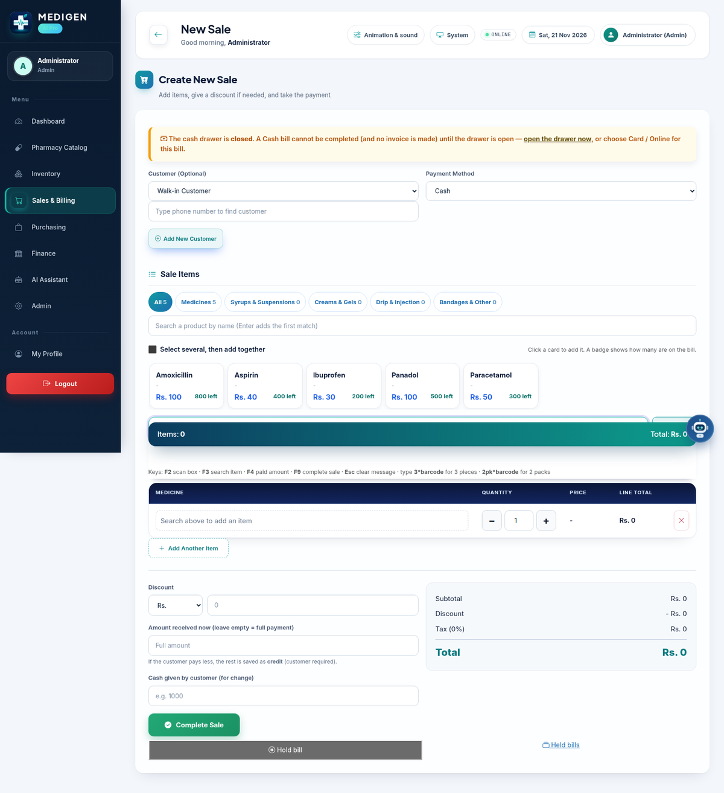
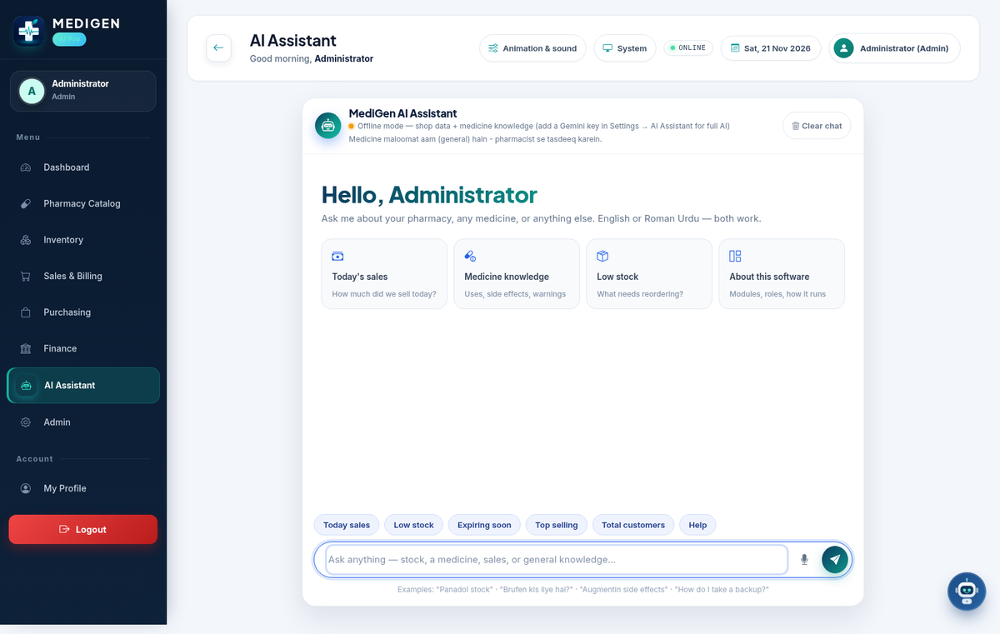
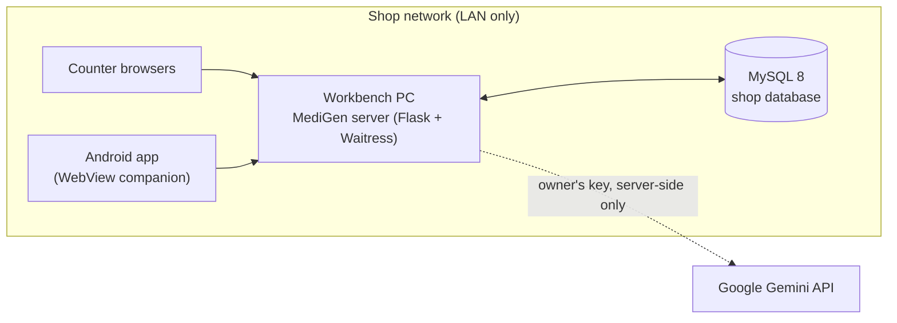

<p align="center">
  
</p>

<h1 align="center">MediGen AI Pro</h1>

<p align="center">
  <b>Pharmacy ERP &amp; Point-of-Sale system for a single-store pharmacy</b><br>
  Billing, inventory, expiry control, purchases, cash drawer and a Gemini-powered
  assistant — running on one Windows PC, reachable from every counter and phone on the shop network.
</p>

<p align="center">
  
  
  
  
  
  
  
</p>

<p align="center">
  <a href="https://github.com/ahmedbux927/MediGen-AI-Pro/actions/workflows/tests.yml"></a>
  <a href="https://github.com/ahmedbux927/MediGen-AI-Pro/releases/latest"></a>
  
  
</p>

<p align="center">
  
</p>

<p align="center">
  <b>
    <a href="#highlights">Highlights</a> ·
    <a href="#download">Download</a> ·
    <a href="#screenshots">Screenshots</a> ·
    <a href="#features">Features</a> ·
    <a href="#architecture">Architecture</a> ·
    <a href="#tech-stack">Tech Stack</a> ·
    <a href="#quick-start-windows">Quick Start</a> ·
    <a href="#testing">Testing</a> ·
    <a href="#roadmap">Roadmap</a> ·
    <a href="#author--contact">Contact</a>
  </b>
</p>

---

## Highlights

<table>
  <tr>
    <td width="50%">
      <b>Built for one real shop</b><br>
      Designed around a single pharmacy workbench PC — no cloud dependency, works fully offline on the local network.
    </td>
    <td width="50%">
      <b>Expiry-safe selling</b><br>
      Batch-wise stock with FEFO (first-expiry, first-out) selling and automatic blocking of expired batches.
    </td>
  </tr>
  <tr>
    <td>
      <b>AI that acts safely</b><br>
      The Gemini assistant reads live shop data and performs actions only through a propose → confirm flow.
    </td>
    <td>
      <b>Proven in production testing</b><br>
      2,509 automated tests, a 38-route role-based QA matrix, and screenshot audits in light and dark mode.
    </td>
  </tr>
  <tr>
    <td colspan="2">
      <b>One-click everything</b> — one launcher, one-click backup with a restore test that proves the backup works, and a one-click Windows installer build.
    </td>
  </tr>
</table>

---

## Watch the Demo

https://github.com/user-attachments/assets/078019e7-8b86-4c8f-8bac-d8756b434224

<p align="center"><i>The official product film (2:21) — press play right here. Full HD master on the <a href="https://github.com/ahmedbux927/MediGen-AI-Pro/releases/tag/v101.03">release page</a>; a 720p copy also lives in <a href="media/MediGen_AI_Pro_Official_Ad.mp4">media/</a>.</i></p>

---

## Download

**[⬇ Latest release — v101.03](https://github.com/ahmedbux927/MediGen-AI-Pro/releases/latest)**

- `MediGenAIPro.apk` — Android companion app
- `MediGen_FULL_v101.03_READY.zip` — complete package (Server + APK + step-by-step guide)
- `MediGen_AI_Pro_Official_Ad_v4.mp4` — **the official product film** (2:21, Full HD, with subtitles & chapters) — watch it on the release page

Release notes and history: [Releases](https://github.com/ahmedbux927/MediGen-AI-Pro/releases) · [CHANGELOG.md](CHANGELOG.md)

---

## Screenshots

<table>
  <tr>
    <td width="50%" align="center">
      <br>
      <i>Dashboard — sales, stock and profit at a glance</i>
    </td>
    <td width="50%" align="center">
      <br>
      <i>Point of Sale — fast billing with pack/unit selling</i>
    </td>
  </tr>
  <tr>
    <td align="center">
      <br>
      <i>Login — role-based access (Admin / Pharmacist / Cashier)</i>
    </td>
    <td align="center">
      <br>
      <i>AI Assistant — answers from live shop data</i>
    </td>
  </tr>
</table>

<p align="center"><i>Screenshots from the live v101.03 app, running on sample data.</i></p>

---

## Features

<table>
  <tr>
    <td width="50%">
      <b>Point of Sale</b><br>
      Fast billing with barcode search, pack/unit selling (<code>2pk*barcode</code>), held bills, discounts, JazzCash / Easypaisa / card / cash, change calculation, invoice QR and WhatsApp share.
    </td>
    <td width="50%">
      <b>Inventory</b><br>
      Batch-wise stock with expiry tracking, FEFO selling, low-stock and expiry alerts, stock counting with approval, barcode label printing.
    </td>
  </tr>
  <tr>
    <td>
      <b>Purchases</b><br>
      Supplier orders, receiving, purchase drafts and returns.
    </td>
    <td>
      <b>Expiry Clearance &amp; Refill Reminders</b><br>
      Near-expiry stock value at risk, and WhatsApp refill reminders for regular customers.
    </td>
  </tr>
  <tr>
    <td>
      <b>Cash Drawer</b><br>
      Open/close sessions with expected-vs-counted reconciliation.
    </td>
    <td>
      <b>AI Assistant (Gemini)</b><br>
      Answers from live shop data with a propose → confirm flow for actions; optional daily AI summary.
    </td>
  </tr>
  <tr>
    <td>
      <b>Reports &amp; Daily Digest</b><br>
      Sales, profit, customer statements, and an owner digest with dues and backup health.
    </td>
    <td>
      <b>Backup You Can Trust</b><br>
      One-click real backup (mysqldump) plus a restore test that proves the backup actually works.
    </td>
  </tr>
  <tr>
    <td>
      <b>Roles &amp; Security</b><br>
      Admin / Pharmacist / Cashier roles, bcrypt passwords, login lockout, CSRF protection, full audit log.
    </td>
    <td>
      <b>Runs Anywhere in the Shop</b><br>
      Windows desktop app (its own window), any browser on the LAN, and an Android companion app.
    </td>
  </tr>
</table>

---

## Architecture



The server runs on one Windows PC. Every other device in the shop reaches it
over the local network — nothing about the shop's data needs the internet.
The Gemini API is called from the server only, with the owner's own key.

---

## Tech stack

<p>
  
  
  
  
  
  
</p>

| Layer | Technology |
|---|---|
| Backend | Python 3, Flask, Waitress |
| Database | MySQL 8 |
| Frontend | Server-rendered templates, vanilla JS, Bootstrap (bundled — works offline) |
| AI | Google Gemini (server-side key, never in the browser) |
| Desktop | pywebview + PyInstaller, Inno Setup installer |
| Android | Native WebView companion (LAN only) |
| Reports | ReportLab, openpyxl |
| CI | GitHub Actions — full test suite on every push |

---

## Quick start (Windows)

```bat
:: 1. Install MySQL 8 and Python 3.10+
:: 2. Load the database
::    (run database\schema.sql, then database\sample_data.sql in MySQL)
:: 3. Copy Server\.env.example to Server\.env and set DB_PASSWORD + SECRET_KEY
:: 4. Start
Server\START_MEDIGEN.bat
```

The browser opens at `http://127.0.0.1:5000`. Other PCs and phones on the
same network use `http://<this-pc-ip>:5000`.

A full walkthrough is in [STEP_BY_STEP_GUIDE.md](STEP_BY_STEP_GUIDE.md).

---

## Windows application (Setup file)

```
Server\MAKE_WINDOWS_APP.bat
```

Builds `MediGenAIPro.exe` (PyInstaller) and then the one-file installer
`dist\MediGen_Setup_101.03.exe` (Inno Setup 6). The target PC needs no
Python. A portable MySQL can be bundled — see `Server/installer/README.md`.

---

## Android app

`MediGenAIPro.apk` (distributed with each release) connects to the shop PC
over the local Wi-Fi and validates that the address is a private LAN
address before connecting.

---

## Project layout

```
Server/            the application (Flask app, templates, static, database, scripts)
Server/pharmacy/   routes, services, AI client, typed errors
Server/database/   schema.sql, sample_data.sql, numbered migrations
Server/android/    Android companion source
Server/installer/  Inno Setup script + build notes
docs/              QA matrix, changelog of the v4 programme, shop test checklist
```

---

## Testing

The automated suite (mock + unit, no database needed) currently reports
**2509 passed, 0 failed** — and runs on every push via GitHub Actions:

```bat
cd Server
python tests\run_all.py
```

---

## Security notes

- Passwords are bcrypt-hashed; API and "remember me" tokens are stored SHA-256 hashed.
- All SQL is parameterized; templates never render unescaped user content.
- No real `.env`, backup, or shop data is ever committed — see `.gitignore`.
- Prescription images are processed locally (Tesseract OCR) and are never
  sent to the AI provider.
- Found a security issue? Please see [SECURITY.md](SECURITY.md).

---

## Roadmap

Under evaluation for future versions:

- Licensed drug-interaction database integration
- Optional cloud hosting with HTTPS for multi-branch access
- FBR (Pakistan tax) integration assessment
- Scheduled WhatsApp digests to the owner

---

## Author & Contact

**Ahmed Bux** — Cybersecurity Professional | SOC Analyst | Linux Admin | AI + Threat Intelligence

<p>
  <a href="https://www.linkedin.com/in/ahmed-bux-5a096a310"></a>
  <a href="https://github.com/ahmedbux927"></a>
  <a href="mailto:ahmedbux927@gmail.com"></a>
</p>

- **Professional enquiries & licensing:** [LinkedIn](https://www.linkedin.com/in/ahmed-bux-5a096a310) — the best way to reach the author
- **Email:** [ahmedbux927@gmail.com](mailto:ahmedbux927@gmail.com)
- **More work:** [github.com/ahmedbux927](https://github.com/ahmedbux927)

---

## License

Proprietary software — © Ahmed Bux. All rights reserved.
See [LICENSE](LICENSE) for the full text.

---

<p align="center">
  <b>If MediGen AI Pro impressed you, consider giving it a ⭐ — it helps the project get discovered.</b><br><br>
  <a href="#medigen-ai-pro">↑ Back to top</a><br><br>
  <i>© 2026 Ahmed Bux · MediGen AI Pro · Built for a real pharmacy, in production daily.</i>
</p>
