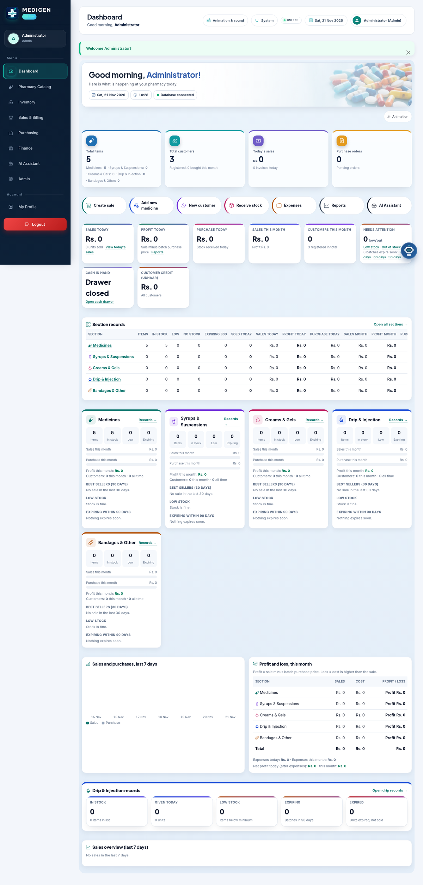
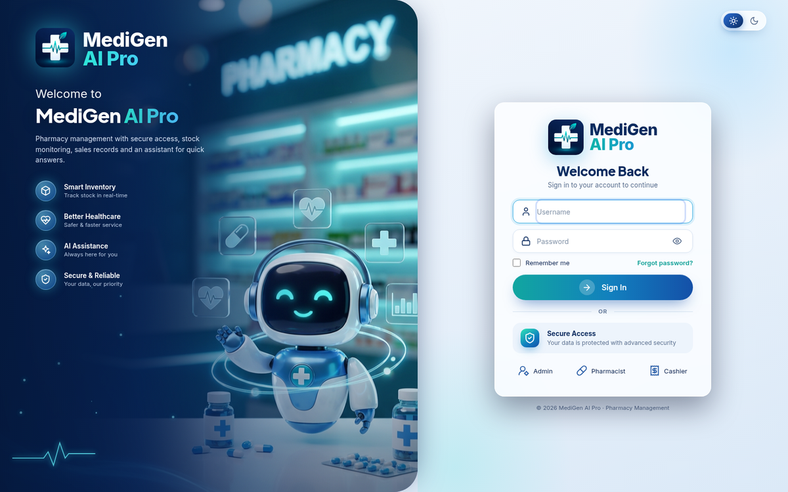
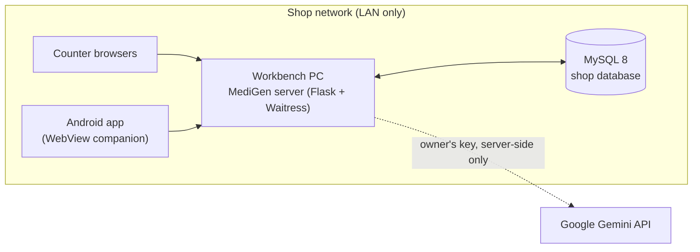

<p align="center">
  
</p>

<h1 align="center">MediGen AI Pro</h1>

<p align="center">
  <b>Pharmacy ERP &amp; Point-of-Sale system for a single-store pharmacy</b><br>
  Billing, inventory, expiry control, purchases, cash drawer and a Gemini-powered
  assistant — running on one Windows PC, reachable from every counter and phone on the shop network.
</p>

<p align="center">
  
  
  
  
  
  
  
</p>

<p align="center">
  
</p>

---

## Contents

- [Highlights](#highlights)
- [Screenshots](#screenshots)
- [Features](#features)
- [Architecture](#architecture)
- [Tech stack](#tech-stack)
- [Quick start (Windows)](#quick-start-windows)
- [Windows application (Setup file)](#windows-application-setup-file)
- [Android app](#android-app)
- [Project layout](#project-layout)
- [Testing](#testing)
- [Security notes](#security-notes)
- [Author](#author)
- [License](#license)

## Highlights

| | |
|---|---|
| **Built for one real shop** | Designed around a single pharmacy workbench PC — no cloud dependency, works fully offline on the local network |
| **Expiry-safe selling** | Batch-wise stock with FEFO (first-expiry, first-out) selling and automatic expiry blocking |
| **AI that acts safely** | The Gemini assistant reads live shop data and performs actions only through a propose → confirm flow |
| **Proven in production testing** | 2,509 automated tests, a 38-route role-based QA matrix, and screenshot audits in light and dark mode |
| **One-click everything** | One launcher, one-click backup with a restore test, one-click Windows installer build |

## Screenshots

<p align="center">
  
  
</p>
<p align="center">
  
  
</p>

<p align="center"><i>From the live v101.03 app, running on sample data.</i></p>

## Features

- **Point of Sale** — fast billing with barcode search, pack/unit selling (`2pk*barcode`), held bills, discounts, JazzCash / Easypaisa / card / cash, change calculation, invoice QR and WhatsApp share
- **Inventory** — batch-wise stock with expiry tracking, FEFO selling, low-stock and expiry alerts, stock counting with approval, barcode label printing
- **Purchases** — supplier orders, receiving, purchase drafts and returns
- **Expiry Clearance & Refill Reminders** — near-expiry stock value at risk, and WhatsApp refill reminders for regular customers
- **Cash drawer** — open/close sessions with expected-vs-counted reconciliation
- **AI Assistant (Gemini)** — answers from live shop data with a propose → confirm flow for actions; daily AI summary (optional)
- **Reports & Daily Digest** — sales, profit, customer statements, and an owner digest with dues and backup health
- **Backup** — one-click real backup (mysqldump) plus a restore test that proves the backup works
- **Roles & security** — Admin / Pharmacist / Cashier, bcrypt passwords, login lockout, CSRF protection, full audit log
- **Runs anywhere in the shop** — Windows desktop app (own window), any browser on the LAN, and an Android companion app

## Architecture



The server runs on one Windows PC. Every other device in the shop reaches it
over the local network — nothing about the shop's data needs the internet.
The Gemini API is called from the server only, with the owner's own key.

## Tech stack

| Layer | Technology |
|---|---|
| Backend | Python 3, Flask, Waitress |
| Database | MySQL 8 |
| Frontend | Server-rendered templates, vanilla JS, Bootstrap (bundled — works offline) |
| AI | Google Gemini (server-side key, never in the browser) |
| Desktop | pywebview + PyInstaller, Inno Setup installer |
| Android | Native WebView companion (LAN only) |
| Reports | ReportLab, openpyxl |

## Quick start (Windows)

```bat
:: 1. Install MySQL 8 and Python 3.10+
:: 2. Load the database
::    (run database\schema.sql, then database\sample_data.sql in MySQL)
:: 3. Copy Server\.env.example to Server\.env and set DB_PASSWORD + SECRET_KEY
:: 4. Start
Server\START_MEDIGEN.bat
```

The browser opens at `http://127.0.0.1:5000`. Other PCs and phones on the
same network use `http://<this-pc-ip>:5000`.

A full walkthrough is in [STEP_BY_STEP_GUIDE.md](STEP_BY_STEP_GUIDE.md).

## Windows application (Setup file)

```
Server\MAKE_WINDOWS_APP.bat
```

Builds `MediGenAIPro.exe` (PyInstaller) and then the one-file installer
`dist\MediGen_Setup_101.03.exe` (Inno Setup 6). The target PC needs no
Python. A portable MySQL can be bundled — see `Server/installer/README.md`.

## Android app

`MediGenAIPro.apk` (distributed with each release) connects to the shop PC
over the local Wi-Fi and validates that the address is a private LAN
address before connecting.

## Project layout

```
Server/            the application (Flask app, templates, static, database, scripts)
Server/pharmacy/   routes, services, AI client, typed errors
Server/database/   schema.sql, sample_data.sql, numbered migrations
Server/android/    Android companion source
Server/installer/  Inno Setup script + build notes
docs/              QA matrix, changelog of the v4 programme, shop test checklist
```

## Testing

The automated suite (mock + unit, no database needed) currently reports
**2509 passed, 0 failed**:

```bat
cd Server
python tests\run_all.py
```

## Security notes

- Passwords are bcrypt-hashed; API and "remember me" tokens are stored SHA-256 hashed.
- All SQL is parameterized; templates never render unescaped user content.
- No real `.env`, backup, or shop data is ever committed — see `.gitignore`.
- Prescription images are processed locally (Tesseract OCR) and are never
  sent to the AI provider.
- Found a security issue? Please see [SECURITY.md](SECURITY.md).

## Author

**Ahmed Bux** — Cybersecurity Professional | SOC Analyst | Linux Admin | AI + Threat Intelligence

- LinkedIn: https://www.linkedin.com/in/ahmed-bux-5a096a310
- GitHub: https://github.com/ahmedbux927

## License

Proprietary software — © Ahmed Bux. All rights reserved.
See [LICENSE](LICENSE) for the full text.
